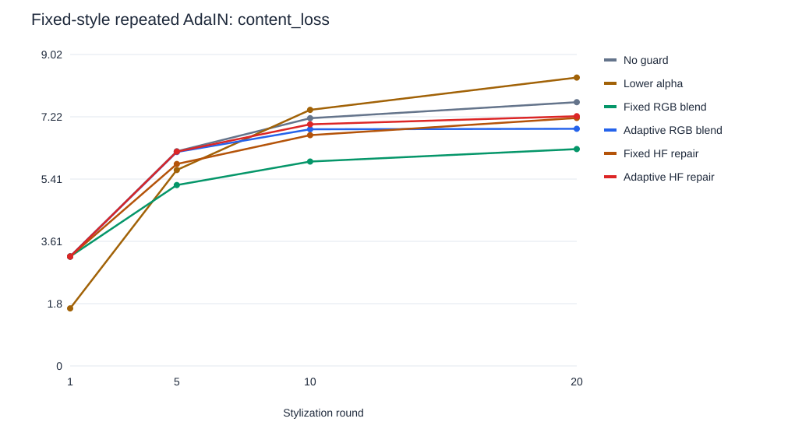
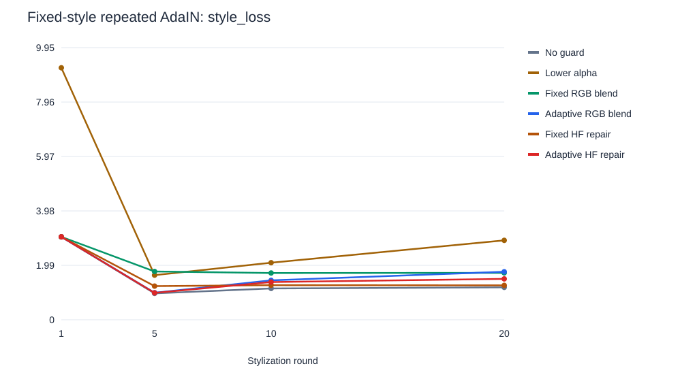

# Adaptive Content Guard for Repeated Neural Style Transfer

A Clemson CPSC 8810 course project investigating whether a lightweight feedback
rule can reduce structural degradation during repeated AdaIN stylization.
The project uses pretrained weights from the upstream
[unofficial PyTorch AdaIN implementation](https://github.com/naoto0804/pytorch-AdaIN).
It does not train a network or modify the AdaIN architecture.

**Current finding:** the proposed adaptive high-frequency guard does not outperform
fixed high-frequency repair on the mean paired content/style loss ratios in this
experiment. The results illustrate a content–style trade-off rather than a
successful elimination of content leak.

- [Full experimental results](guard_experiment/RESULTS.md)
- [Per-round measurements](guard_experiment/metrics.csv)
- [Final-round summary](guard_experiment/summary.csv)
- [Paired ratios and bootstrap intervals](guard_experiment/paired_bootstrap.json)
- [Example comparison](guard_experiment/example_6_blonde_girl.jpg)

## Research question

Repeatedly applying a stylizer can gradually distort the original content.
Can an inference-time controller detect additional edge degradation and restore
some original information while retaining the target style?

Each sequence uses **one fixed style image for all 20 rounds**. The previous
round's corrected image becomes the next round's input. The unchanged original
photo remains available only as a reference for monitoring, evaluation and repair.

## Methods

Let `C` be the original photo, `X[t-1]` the previous corrected result, and `S` the
fixed style. AdaIN first generates the candidate:

```text
Y[t] = AdaIN(X[t-1], S, alpha)
```

| Method | Alpha | Intervention after round 1 |
|---|---:|---|
| No guard | 0.75 | None |
| Lower alpha | 0.375 | None |
| Fixed RGB blend | 0.75 | Blend the original RGB photo with beta=0.1 |
| Adaptive RGB blend | 0.75 | Blend RGB using the feedback-controlled beta |
| Fixed HF repair | 0.75 | Restore grayscale high-frequency residuals with beta=0.1 |
| Adaptive HF repair | 0.75 | Restore residuals using the feedback-controlled beta |

Alpha interpolates **features inside AdaIN**, not final RGB pixels. Beta controls
the separate image-space repair. All four repair methods leave round 1 untouched.

### Edge monitoring and adaptive intervention

Convert each image to grayscale, apply Gaussian prefiltering with sigma=1, and
compute a Sobel gradient magnitude `E`. The similarity score is

```text
q[t] = 1 - sum(abs(E(C) - E(Y[t]))) / (sum(E(C)) + sum(E(Y[t])) + 1e-8)
threshold = retention * q[1]
beta[t] = clip(gain * (threshold - q[t]) / max(threshold, 1e-6), 0, beta_max)
```

The score is clipped to [0,1]. The first-round reference permits initial artistic
change and monitors subsequent degradation. Selected parameters are
`retention=0.8`, `gain=2.0`, `beta_max=0.6`. There is one beta for the whole image;
the rule does not learn spatially varying interventions or adjust alpha.
It performs one correction, without guaranteeing that the threshold is restored.

### RGB blending

```text
X[t] = (1 - beta[t]) * Y[t] + beta[t] * C
```

This restores original colors and structure, potentially weakening stylization.

### High-frequency (HF) repair

```text
H(I) = gray(I) - GaussianBlur(gray(I), sigma=1.5)
X[t] = clip(Y[t] + beta[t] * (H(C) - H(Y[t])), 0, 1)
```

The grayscale correction is broadcast to the three RGB channels. It replaces
some current high-frequency brightness information with that of the original.
Artistic brushstrokes and noise also contain high frequencies. Consequently,
this operation can remove style textures, introduce halos, alter colors through
clipping, and fail to recover displaced geometry.

## Experimental design

| Setting | Value |
|---|---|
| Test content photos | `cornell`, `newyork`, `golden_gate`, `flowers`, `brad_pitt`, `blonde_girl` |
| Test style paintings | `brushstrokes`, `asheville`, `picasso_self_portrait`, `the_resevoir_at_poitiers` |
| Calibration photos | `modern`, `avril` |
| Calibration paintings | `mondrian`, `woman_with_hat_matisse` |
| Input preprocessing | RGB, aspect-preserving resize, square center crop to 192×192 |
| Main experiment | 24 photo/style pairs × 6 methods × 20 rounds = **2,880 outputs** |
| Saved checkpoints | Rounds 1, 5, 10 and 20: **576 PNG images**, kept locally |
| Precision between rounds | Floating point; no repeated resizing or JPEG re-encoding |
| Inference | CPU, no training |

Calibration uses four photo/style pairs, ten rounds, and retention candidates
0.6, 0.8 and 0.95. It minimizes the average of
`log(content_loss / no_guard_content_loss) + log(style_loss / no_guard_style_loss)`
across both adaptive variants. Gain, beta cap and fixed beta are prespecified.
Both content photos and style paintings are disjoint between calibration and test.
Parameters are frozen before test evaluation.

## Evaluation

- **VGG content loss:** relu4_1 feature mean squared error (MSE) against the
  original content photo. Lower means more similar features, not a guaranteed
  measure of semantic identity.
- **Gram style loss:** average Gram-matrix MSE at relu1_1, relu2_1, relu3_1 and
  relu4_1 against the style reference, with `Gram(F) = FF^T / (H*W)`. Lower means
  closer feature statistics, not necessarily better visual quality.
- **Grayscale SSIM:** similarity to the original; higher is better. The Gaussian
  window uses sigma=1.5, C1=0.01², C2=0.03², with a five-pixel border excluded.
- **Edge score:** the guard's own monitoring signal; higher is better but is not
  independent validation of the guard.
- **Interventions and timing:** beta, activation frequency and seconds per round.

Quality metrics are evaluated at saved checkpoints. Monitoring and timing are
logged every round. All methods execute monitoring for diagnostics; reported CPU
timing includes inference/monitoring/correction but excludes metric evaluation,
image saving and model loading.

For each photo/style pair, the final-round loss is divided by its no-guard loss.
Ratios are averaged within photo, then across six photos. A ratio below 1 means
lower error; it is **not a percentage of semantic content retained**. Intervals
use 2,000 bootstrap resamples of whole photo clusters, seed 0. Repeated rounds are
not treated as independent observations.

## Results

Final-round paired mean ratios relative to no guard (both lower is better):

| Method | VGG content ratio | Gram style ratio |
|---|---:|---:|
| No guard | 1.000 | 1.000 |
| Lower alpha | 1.094 | 2.617 |
| Fixed RGB blend | 0.822 | 1.443 |
| Adaptive RGB blend | 0.900 | 1.418 |
| Fixed HF repair | 0.943 | 1.063 |
| Adaptive HF repair | 0.948 | 1.218 |

Adaptive HF reduces VGG content error by about 5.2% while increasing Gram style
error by about 21.8%. Fixed HF reduces content error by about 5.7% with a 6.3%
increase in style error. The adaptive HF variant therefore does not improve the
mean trade-off relative to fixed HF in this setup. RGB blending restores more
content at a larger style-error cost. These means do not establish statistical
superiority across all datasets or settings.




An additional diagnostic repeatedly encodes/decodes two calibration photos with
alpha=0, producing 40 separate outputs. It shows that reducing style interpolation
to zero does not make the encoder/decoder an identity mapping: reconstruction
errors can still accumulate. See the full results for its measurements.

### Limitations

The experiment covers one stylizer, one primary alpha, one resolution and a small
set of upstream images. Fixed beta was not comprehensively tuned. There is no
human preference study or evidence of broad model independence. Edge scores and
high-frequency residuals do not capture semantic correctness; repaired examples
still exhibit geometric drift. The proposed heuristic is a course-project design,
not an established claim of field-wide novelty or lossless preservation.

## Setup

Use a Python version supported by your PyTorch build. The local execution used
Python 3.14.9, PyTorch 2.15.0+cpu, NumPy 2.5.4 and Pillow 13.0.0 on Windows.
Exact recorded versions and checkpoint hashes are in
[environment.json](guard_experiment/environment.json) and
[manifest.json](guard_experiment/manifest.json). 

The guard pipeline requires only PyTorch, NumPy and Pillow. It does not require
TorchVision, OpenCV or training dependencies.

Download `decoder.pth` and `vgg_normalised.pth` from the
[upstream model release](https://github.com/naoto0804/pytorch-AdaIN/releases/tag/v0.0.0)
and place them in `models/`. The supplied `input/` images must also be present.
Weights are excluded from Git.

## Reproduce

Run these commands from the repository root with the environment activated.

```bash
# Quick integration check: all six methods, one pair, three rounds.
python experiment_guard.py --smoke

# Full calibration and test experiment; use a new output directory.
python experiment_guard.py --output guard_run --size 192 --rounds 20 --alpha 0.75 --threads 4

# Optional alpha-zero reconstruction diagnostic.
python diagnose_reconstruction.py --output guard_run --size 192

# Validate all raw checkpoints and produce reports, plots and contact sheets.
python analyze_guard.py --output guard_run --require-images

# Recompute statistics/plots from the compact published data, without inference.
python analyze_guard.py --output guard_experiment

# Regression checks do not need model weights.
python -m unittest discover -s tests -v
```

CPU is the default. The full inference run can take tens of minutes depending on
hardware. For a CUDA-compatible environment, add `--device cuda` to inference and
diagnostic commands. `--size` must be a multiple of eight and at least 32. Use the
same size for the main run and diagnostic. The primary paper-style comparison is
the default 20-round configuration.

The analysis can operate on published CSVs when full PNG checkpoints are absent;
`--require-images` additionally checks every local checkpoint. Existing published
contact sheets remain unchanged when PNGs are absent. A fresh run produces its own
contact sheets. Using an existing output directory overwrites that run's files;
use a new directory for changed configurations.

## Repository layout

```text
experiment_guard.py          Repeated AdaIN, guard rules, calibration and logging
analyze_guard.py             Validation, paired statistics, SVG plots and reports
diagnose_reconstruction.py   Alpha-zero encoder/decoder diagnostic
tests/test_guard.py          Regression tests for intervention behavior
guard_experiment/            Compact published data, reports and figures
  metrics.csv               Per-round measurements
  calibration.csv           Calibration measurements
  parameters.json           Selected settings and calibration scores
  manifest.json             Execution metadata, split and checkpoint hashes
  input_assets.json         Input filenames, sizes and hashes
  summary.csv               Final-round absolute metric means
  paired_bootstrap.json     Paired loss ratios and uncertainty
  validation.json           Data/checkpoint validation status
  RESULTS.md                Generated English report
  *.svg, example_*.jpg       Curves and predetermined contact sheets
  images/                   Local PNG checkpoints, excluded from Git
net.py, function.py          Original upstream model and AdaIN implementation
README.md, LICENSE          Original upstream documentation and license
```

Current results retain existing inference measurements; statistics and figures
were regenerated for the published scope. `execution_code_sha256` records the
original runner digest; `runner_after_cleanup_sha256` identifies the cleaned
runner. These are provenance fields, not a claim that the historical execution
used the refactored file. Fresh runs record their current runner hash directly.
No checkpoint files, virtual environment, full intermediate image set, smoke
outputs or local `guard_run*` folders are included by `.gitignore`.

## Attribution and references

The upstream implementation is by Naoto Inoue and is distributed under the
[MIT license](LICENSE). Its architecture, pretrained weights and supplied example
assets are credited to the upstream repository. This project adds inference-time
guard policies, the evaluation pipeline and reports. The software license does
not independently establish rights to every supplied photograph or painting.

- Huang, X. and Belongie, S. **Arbitrary Style Transfer in Real-time with Adaptive
  Instance Normalization.** ICCV 2017.
  [Paper](https://arxiv.org/abs/1703.06868) ·
  [Authors' Torch implementation](https://github.com/xunhuang1995/AdaIN-style)
- An, J. et al. **ArtFlow: Unbiased Image Style Transfer via Reversible Neural
  Flows.** CVPR 2021.
  [Paper](https://arxiv.org/abs/2103.16877).
  ArtFlow motivates the content-leak problem; it is related work, not an evaluated
  model in this project.
