# Adaptive Content Guard: experimental results

## Scope

6 test photos × 4 fixed styles × 6 methods × 20 rounds = 2,880 outputs. Each sequence repeatedly applies one style to the previous round. Resolution: 192 square pixels; primary alpha: 0.75. Calibration photos and styles are disjoint from test assets. No model training was performed.

Selected parameters: `{"retention": 0.8, "beta_max": 0.6, "gain": 2.0, "fixed_beta": 0.1}`.

## Round-20 results

| Method | Gray SSIM ↑ | Edge score ↑ | VGG content ↓ | Gram style ↓ | ms/round* | Trigger % |
|---|---:|---:|---:|---:|---:|---:|
| No guard | 0.0943 | 0.4495 | 7.6415 | 1.1850 | 145.0 | 0.0 |
| Lower alpha | 0.0967 | 0.4459 | 8.3545 | 2.9023 | 146.2 | 0.0 |
| Fixed RGB blend | 0.1790 | 0.4761 | 6.2829 | 1.7142 | 145.6 | 95.0 |
| Adaptive RGB blend | 0.1403 | 0.4700 | 6.8707 | 1.7544 | 147.2 | 27.9 |
| Fixed HF repair | 0.1375 | 0.4590 | 7.1843 | 1.2576 | 149.5 | 95.0 |
| Adaptive HF repair | 0.1199 | 0.4584 | 7.2351 | 1.4943 | 148.4 | 27.9 |

*Timing includes inference, edge monitoring and correction; it excludes evaluation, saving and model loading. All methods compute monitoring for diagnostics. Single-run CPU timings describe this harness, not optimized standalone inference.*

## Paired loss ratios

| Method | Content ratio [95% interval] | Style ratio [95% interval] |
|---|---:|---:|
| No guard | 1.000 [1.000, 1.000] | 1.000 [1.000, 1.000] |
| Lower alpha | 1.094 [1.078, 1.109] | 2.617 [2.385, 2.855] |
| Fixed RGB blend | 0.822 [0.810, 0.833] | 1.443 [1.355, 1.542] |
| Adaptive RGB blend | 0.900 [0.831, 0.970] | 1.418 [1.091, 1.798] |
| Fixed HF repair | 0.943 [0.931, 0.952] | 1.063 [0.982, 1.138] |
| Adaptive HF repair | 0.948 [0.906, 0.987] | 1.218 [1.024, 1.431] |

Ratios compare the same photo/style pair against no guard at the final round. Below 1 means lower error. Ratios are averaged within photo, then across photos. Intervals use 2,000 photo-cluster bootstrap samples, seed 0. Six photos provide limited generalizability.

## Interpretation

Lower content loss with higher style loss represents a trade-off, not an unconditional improvement. The adaptive HF guard does not establish superiority over fixed HF repair here. Edge monitoring and grayscale residual repair cannot guarantee semantic or geometric preservation; examples still show structural drift.

## Metrics and limitations

Content loss is VGG relu4_1 feature MSE against the original. Style loss averages Gram MSE at relu1_1/2_1/3_1/4_1 against the fixed style, with Gram=FFᵀ/(HW). Grayscale SSIM uses Gaussian sigma 1.5, C1=0.01², C2=0.03² and a five-pixel excluded border. Edge score is the controller signal, not independent evidence. Raw loss values are implementation-specific; a reduction is not a percentage of semantic content retained.

Only AdaIN, one primary alpha and one resolution were tested. Fixed beta was not exhaustively tuned. High-frequency repair can erase artistic texture, cause halos and clipping. No human aesthetic study or broad novelty claim is established. See [README_GUARD.md](../README_GUARD.md) for the method, citations and reproduction commands.

## Alpha-zero reconstruction diagnostic

Two calibration photos each traverse the encoder/decoder for 20 rounds at alpha=0. These 40 outputs are separate from the main experiment.

| Photo | Round | SSIM | VGG content loss |
|---|---:|---:|---:|
| modern | 1 | 0.3730 | 1.4369 |
| modern | 20 | 0.0731 | 12.3382 |
| avril | 1 | 0.6187 | 0.5794 |
| avril | 20 | 0.1231 | 10.8930 |

## Figures

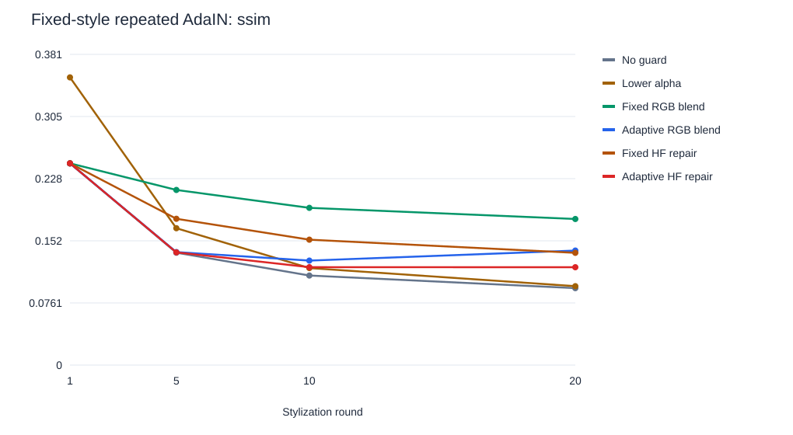

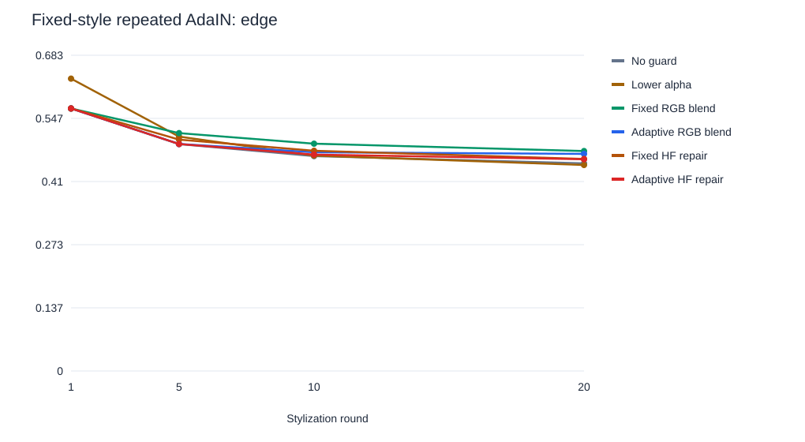

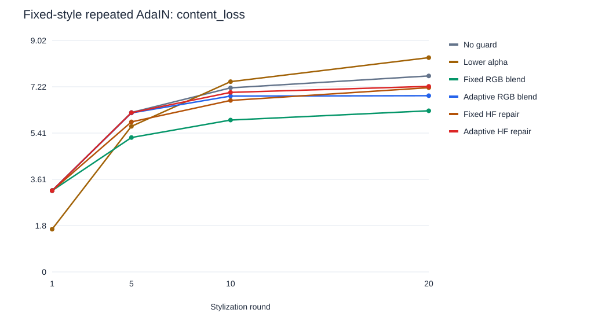

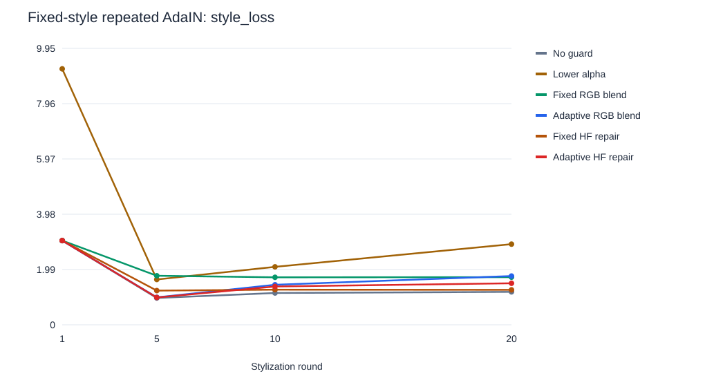

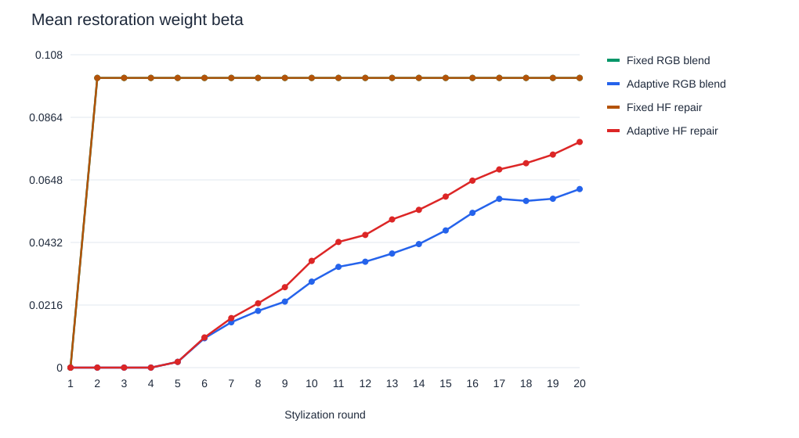

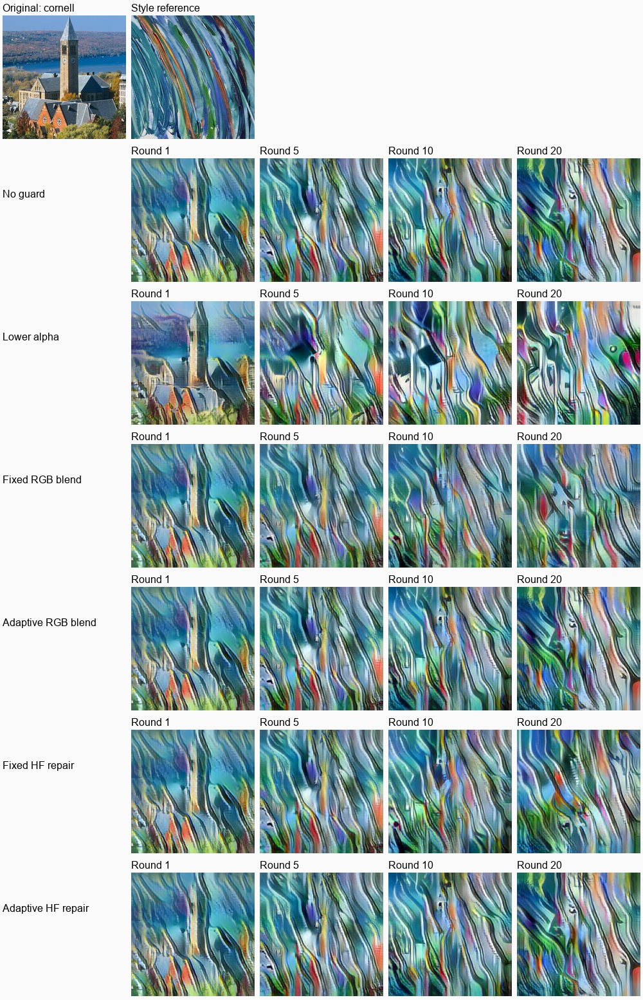

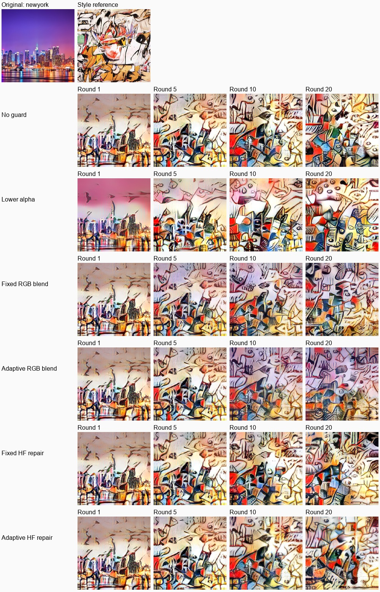

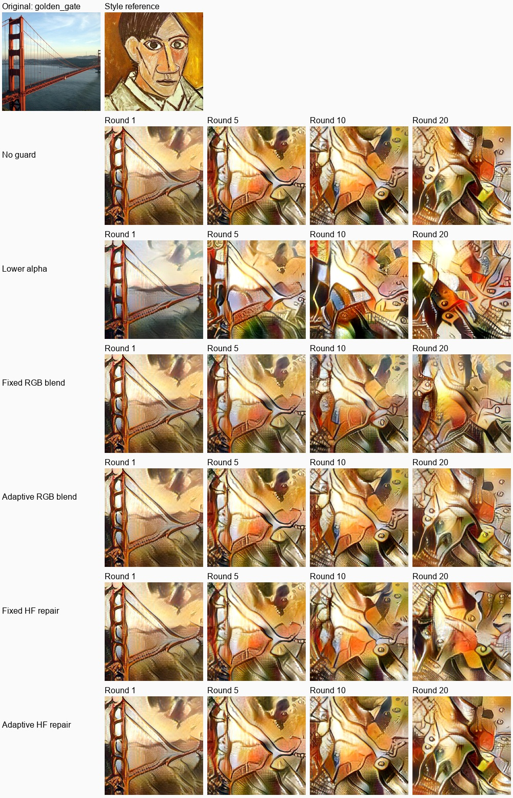

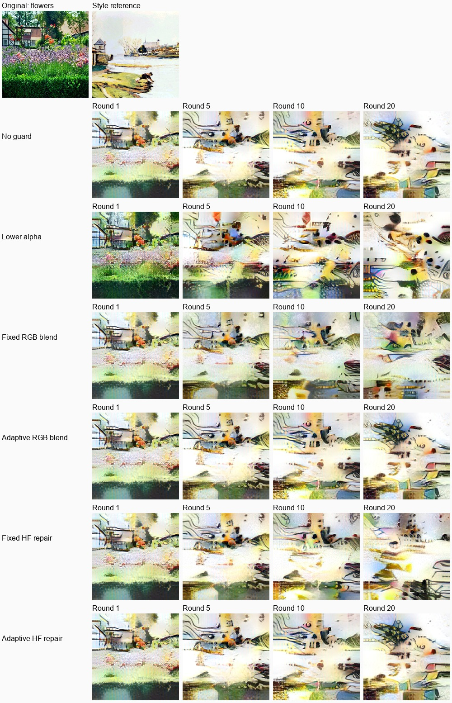

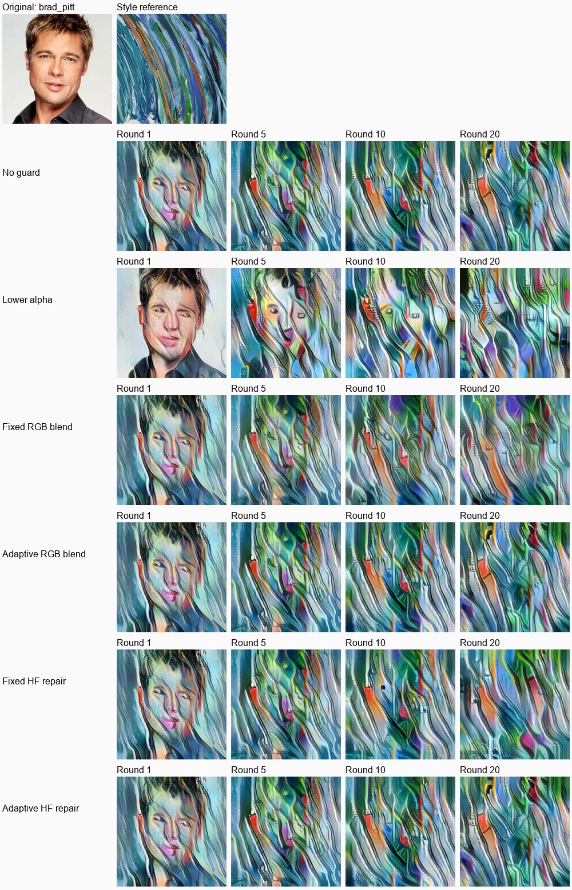

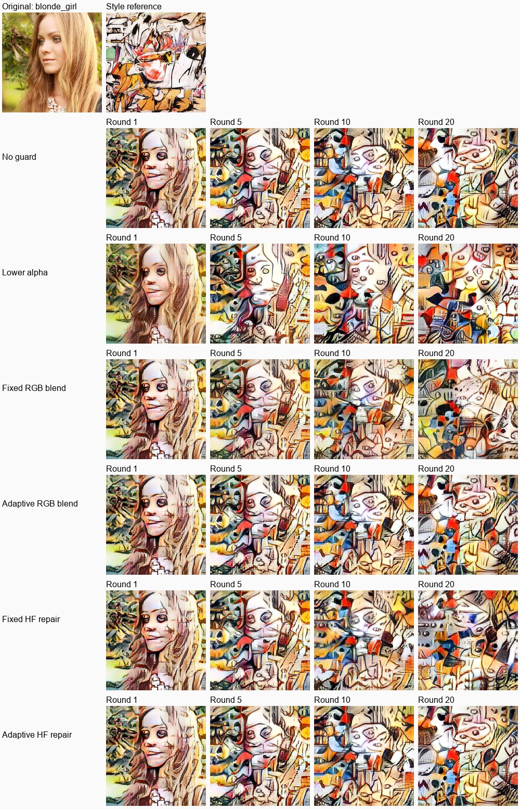

Examples are chosen by list order, without selecting favorable scores. Full PNG checkpoints are local outputs excluded from Git. Compact CSV/JSON results, SVG plots and JPEG contact sheets are published.